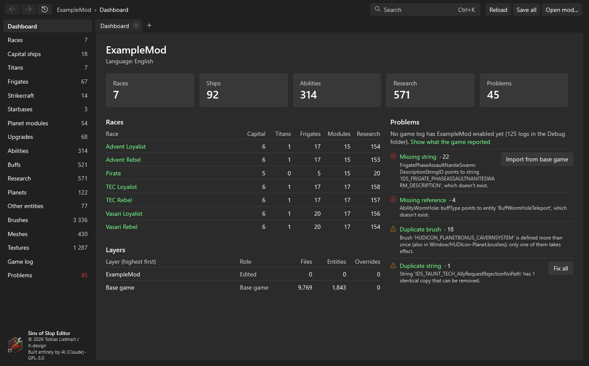

<p align="center"></p>

# Sins of Slop Editor

> [!IMPORTANT]
> **This project is built entirely by AI.** Every line of code, every test, the build scripts, this README, the
> manual and all graphics (logo, icon) were created by **Claude (Anthropic)**. I didn't write a single line of code by
> hand. I decided what to build, tested it on my own mods and reported what was wrong; Claude wrote and changed
> everything. The name says as much: it's AI "slop" – useful and tested, but read the code with that in mind.

A mod editor for **Sins of a Solar Empire: Rebellion** (Windows). It opens a mod on top of the game and any base mods,
and lets you browse, edit, check and preview everything in it – entities, strings, research trees, brushes, textures
and meshes – while keeping the game's file formats exactly as they are.

**[Read the manual](https://tobiwahnkenobi.github.io/SinsOfSlopEditor/)** · **[Download the latest release](https://github.com/TobiWahnKenobi/SinsOfSlopEditor/releases/latest)**



## What it does

- **Layers:** base game < base mods < your mod. You see the effective result and where every file comes from; saving
  writes only into your mod (copying a file from below on first change).
- **Entities:** races, ships, abilities, buffs, research, planets … as forms with typed fields, pickers for references,
  undo/redo, raw text, duplicate/rename/delete with all references updated. Strings are edited right where they're used.
- **Research trees:** the race's research screen drawn from the game's own layout and images; drag subjects, link
  prerequisites, create new subjects in free cells.
- **Brushes:** create and change button and icon images, packed into texture atlases with their state variants.
- **Meshes:** a 3D view that draws with the game's own shaders (ships, asteroids, planets, skyboxes, particle effects),
  a cel-shading style for HUD icons, pictures for brushes, and scaling to a target size.
- **Problems:** missing references and strings, wrong value kinds, count and manifest mismatches, encoding, and what
  the game's AI needs to play a race – with one-click fixes where the fix is obvious. Reads the game's debug logs too.
- **Lossless:** files are read and written line by line with the game's encoding and line endings; binary files go
  through the game's own `ConvertData`.

## Requirements

- Windows 10 or 11, 64-bit, with Direct3D 11
- An installed copy of *Sins of a Solar Empire: Rebellion* (the editor uses its files and its `ConvertData` tool)

The release is a single self-contained `.exe`; no .NET installation is needed.

## Building

```
dotnet build SinsEditor.sln
dotnet test tests/SinsEditor.Tests
pwsh build/publish.ps1        # release zip in dist/
```

Needs the .NET 9 SDK. Most tests need the game: copy `testpaths.local.json.example` to `testpaths.local.json` and set
the game folder (and optionally a test mod); without it they're skipped.

## Licence

- Source code, tests, scripts and documentation: **GNU GPL v3.0** – [`LICENSE`](LICENSE)
- Logos and icons: **all rights reserved**, usable only to build this editor – [`LICENSE-ASSETS.md`](LICENSE-ASSETS.md)
- Third-party libraries in the release (all MIT): [`THIRD-PARTY-NOTICES.md`](THIRD-PARTY-NOTICES.md) and [`licenses/`](licenses)

*Sins of a Solar Empire* is a trademark of Stardock Entertainment and Ironclad Games. This project isn't affiliated
with or endorsed by them, and contains none of the game's files.

© 2026 Tobias Liebhart / lt-design
