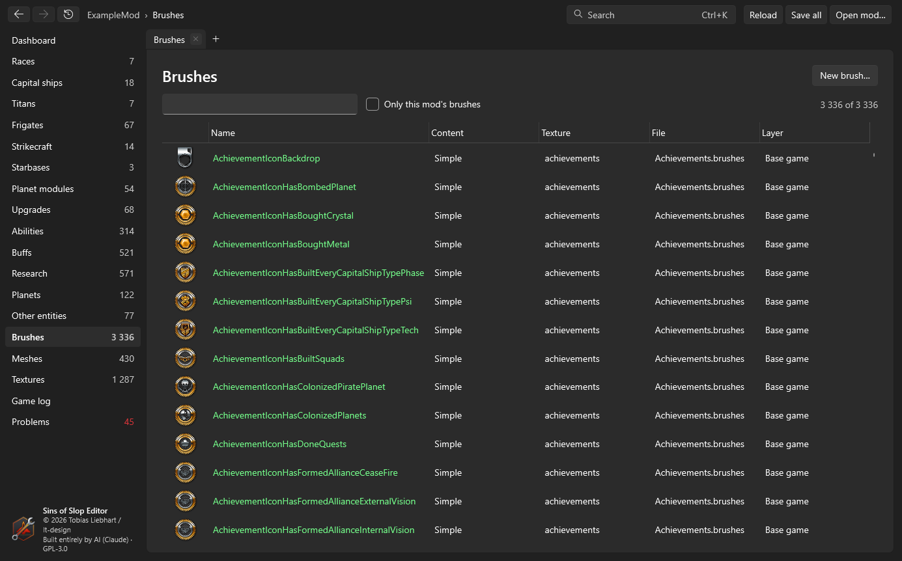
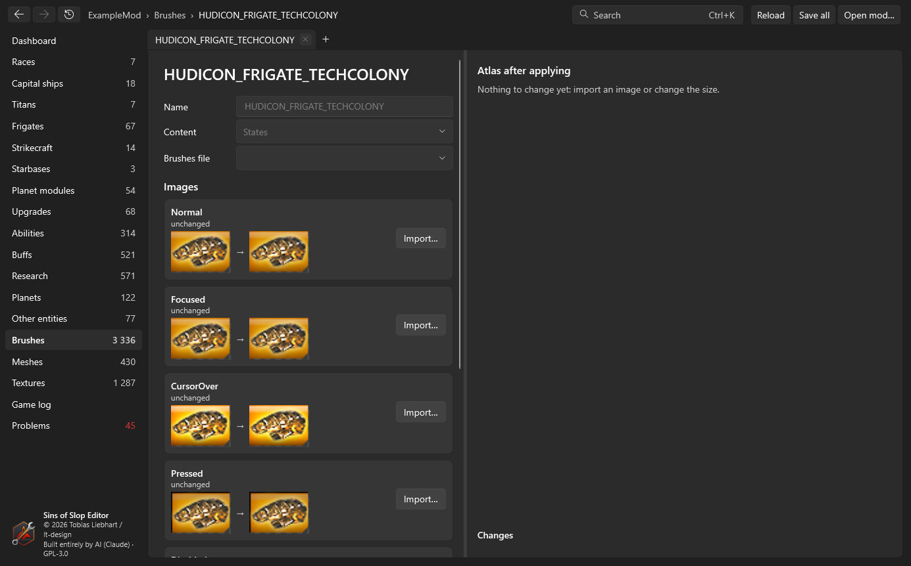

# Brushes

Brushes are the game's named images: HUD icons, buttons, backdrops. Each one is a rectangle of a texture (an "atlas"),
defined in a `Window/*.brushes` file listed in `brush.manifest`. Buttons have one image per **state** – Normal,
CursorOver, Pressed, Focused, Disabled.

## The brush list

**Brushes** in the sidebar lists every brush with a preview, its file, texture and layer. Search by name, texture or
file; *Only this mod's brushes* hides the rest. **New brush…** starts an empty one.

## The brush editor

Open a brush from the list, or with the pencil next to a brush reference on an entity page.

- **Name** and **Brushes file** – where the brush is defined. A new brush can go into an existing file or a new one in
  `Window/` (added to `brush.manifest`).
- **Content** – *Simple* (one image) or *States* (the five button states).
- **Images** – one slot per state. **Import…** loads a picture (PNG, JPG, BMP, TGA, DDS …). *Fit* keeps its
  proportions with transparent margins, *Fill* crops, *Stretch* uses the exact size. **Generate the other states from
  Normal** makes CursorOver brighter, Pressed darker and Disabled grey; a state with its own imported image keeps it.
  **Undo import** brings back the current image.
- **Texture (atlas)** – the new images go into an **existing texture** (packed into free space, the atlas grows if
  needed) or a **new texture** (TGA as the game uses for most icons, or DXT5 DDS, which is smaller). If the new images
  have the same size as the old ones, they are written in place and nothing else moves.
- **Changes** lists every file that will be written; **Atlas after applying** shows the texture as it will be.
  **Apply** writes them: the texture (with mipmaps for DDS) and every brush whose rectangle moved.

{: .note }
A brush's picture can also come straight from the [mesh view](meshes.html#pictures-and-brush-images): render a ship
on the brush's current image and send it to the brush editor with **Use in brush…**.
