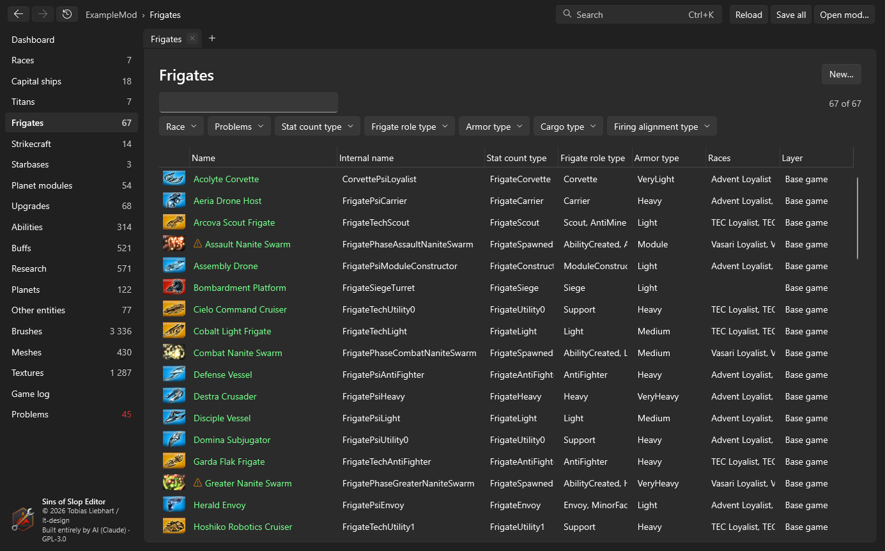
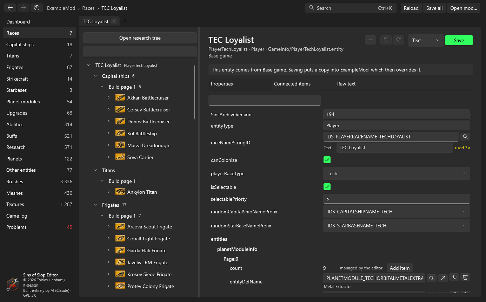
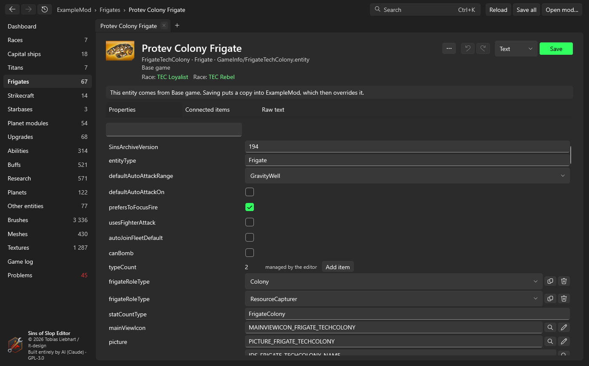
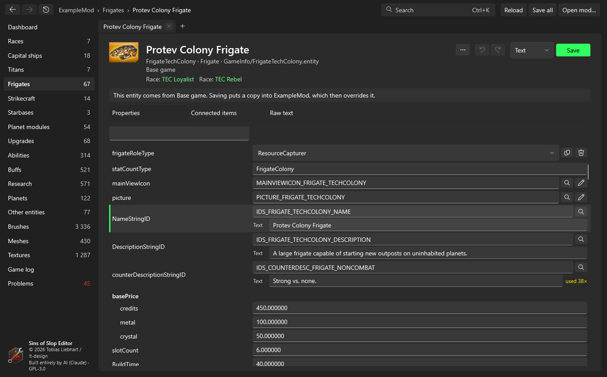

# Entities
{: .no_toc }

Everything the game defines in `GameInfo/*.entity` files – races, capital ships, titans, frigates, strikecraft,
starbases, planet modules, upgrades, abilities, buffs, research subjects, planets and the rest.

1. TOC
{:toc}

## Lists

The sidebar has one list per kind of entity. Each row shows the display name (from the string table), the internal
name, the layer it comes from and the races that use it; a warning sign marks entities with problems.

- **Search** filters by name, internal name or race.
- The **filters** above the list narrow it down by values the entities have (for example their race or type).
- **New…** creates an entity from a template – the selected row, or one you pick (see [Duplicate](#duplicate-rename-delete)).

## Race pages

A race lists everything it can build and research, grouped like the game's build menus, with a filter. **Open research
tree** opens the [research tree editor](research.html).

## The entity page

At the top: the entity's icon, display name, internal name, type, file, and the layer it comes from. If it comes from
the base game or a base mod, a note says that saving puts a copy into your mod.

If the entity has problems, a box lists them; click a line number to jump to that line.

The page has three tabs.

### Properties

Every line of the entity as a form, in file order, indented like the file:

- **Yes/no values** are checkboxes, **numbers** are number fields (wrong input is marked), **text** is a text box.
- **Values with known choices** (seen elsewhere in the game) are drop-downs that still accept other text.
- **References** to other entities, brushes, meshes, textures, sounds or strings get a picker (magnifier) listing
  everything that fits, with search. Next to the field:
  - an arrow opens the referenced entity (Ctrl+click: in a new tab),
  - a pencil opens a brush in the [brush editor](brushes.html),
  - an eye opens a mesh or texture in the [viewer](meshes.html).
  A reference to something that doesn't exist is marked red.
- **Lists:** the counter of a list (for example `numWeapons`) is *managed by the editor*: **Add item** adds an entry,
  and the buttons next to an entry duplicate or remove it. The count is always kept right, because the game reads
  exactly that many entries.
- The filter box at the top finds properties by key, value or string text.

### Strings, edited where they're used

A string reference (`NameStringID`, `DescriptionStringID` …) shows the string's **text** in a box right below the ID.
Change the text and leave the box: the editor writes it into your mod's string file for the current language at once
(copying the table from below first, if your mod has none yet).

- If the string is used by other entities too, **used N×** appears next to it – changing the text changes it for all
  of them. Give the entity its own string ID first if you want a different text.
- An **unknown string ID** shows **+ New string**: click it, type the text, and the string is added to your string file
  (and the missing-string problem disappears).

{: .note }
String texts are written to the string file immediately; the entity's own undo doesn't take them back.

### Connected items

What the entity **uses** (entities, strings, brushes, meshes …, grouped, with line numbers) and what **uses it**, plus
the races that have it. Every entry is a link.

### Raw text

The entity as text, in an editor with line numbers. Changes are applied to the form when you switch back or save.

## Saving

- **Save** (**Ctrl+S**) writes the entity into your mod. The format box next to it chooses **text** or **binary**
  (converted with the game's `ConvertData`); by default the format the mod's copy already has.
- **Undo/redo** (**Ctrl+Z** / **Ctrl+Y**) work per entity, across all tabs showing it.
- Unsaved entities show a dot in their tab; **Save all** saves them all.

## Duplicate, rename, delete

The **…** button on an entity page (and **New…** on lists) opens a dialog that first shows every file it would change:

- **Duplicate / new from template:** a copy under a new name, added to `entity.manifest`. Optionally it gets its own
  name and description strings (copied from the template), and it's added to the same race lists as the template.
- **Rename:** the entity file, its manifest entry and every reference to it in other entities.
- **Delete:** removes it from the manifest and your mod; optionally removes it from lists and clears references to it.
  For an entity your mod only overrides, you can instead delete just your copy and use the base version again.

Unsaved changes are saved or discarded first; afterwards the mod is reloaded.
