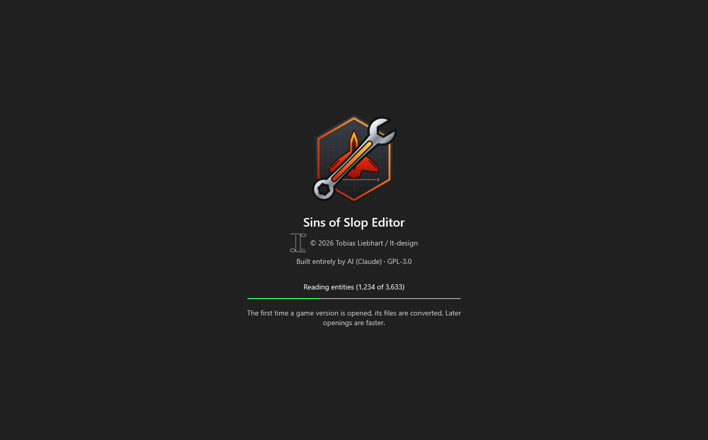
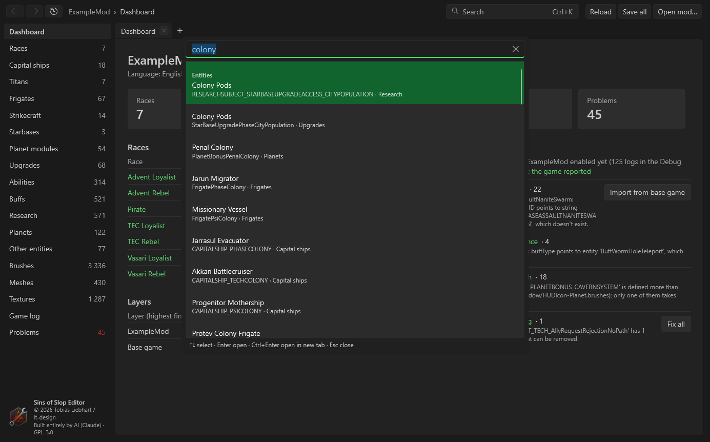
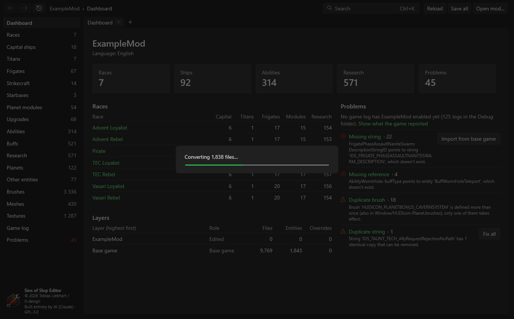

# Getting started
{: .no_toc }

1. TOC
{:toc}

## Install

1. Download `SinsOfSlopEditor-1.0.0-win-x64.zip` from the
   [releases page](https://github.com/TobiWahnKenobi/SinsOfSlopEditor/releases/latest).
2. Unzip it anywhere, e.g. `C:\Tools\SinsOfSlopEditor`.
3. Run `SinsOfSlopEditor.exe`.

Nothing else needs to be installed – the .NET runtime is inside the program. Windows may warn that the program is from
an unknown publisher, because it isn't signed; choose *More info → Run anyway*.

## Open a mod

On the first start the editor asks what to open:

- **Game folder** – where *Sins of a Solar Empire: Rebellion* is installed, e.g.
  `C:\Program Files (x86)\Steam\steamapps\common\Sins of a Solar Empire Rebellion`. The editor reads the game's files
  from here and uses its `ConvertData_Rebellion.exe` for binary files.
- **Mod to edit** – the mod you work on. Mods are looked for in the game's mod folder under *Documents\My Games*;
  *Browse…* picks any folder.
- **Base mods** – mods your mod builds on (for example a big overhaul your mod extends). They are loaded read-only, in
  the order shown, on top of the base game. The edited mod overrides all of them. If your mod is listed after others in
  the game's `EnabledMods.txt`, they are offered here.
- **Language** – which string table to show and edit (English by default).

*Open mod…* at the top right opens this window again later; the editor remembers the last mods and their base mods.

{: .note }
The first time a game version is opened, the editor converts its binary files to text (into a cache, not into the
game). That takes a minute or two; later starts are much faster.

## Layers: where things come from

Everything you see is the **effective** mod: the base game, then the base mods, then your mod, each file overriding the
same file below it. Pages show which layer a file comes from ("Base game", a base mod's name, or your mod).

When you change something that comes from a lower layer and save, the editor puts a copy into your mod, which then
overrides the original. Lower layers are never changed.

## Finding your way around

- **Sidebar** – the dashboard, one entry per kind of entity (races, capital ships, frigates …), then brushes, meshes,
  textures, the game log and the problem list. The numbers are how many there are.
- **Tabs** – every page opens in a tab. *+* or **Ctrl+T** opens a new tab, **Ctrl+W** or the middle mouse button on a
  tab closes it. **Ctrl+click** or the **middle mouse button** on a link opens it in a new tab;
  **Shift+middle-click** opens it in a background tab.
- **Back and forward** – the arrows, or **Alt+Left** / **Alt+Right**, per tab. The clock button lists recently opened
  pages.
- **Search** – **Ctrl+K** searches everything: entities by name and display name, strings, brushes, meshes, textures.
  Arrow keys choose, **Enter** opens, **Ctrl+Enter** opens in a new tab.

- **Save** – **Ctrl+S** saves the current entity, **Save all** (**Ctrl+Shift+S**) every entity with unsaved changes.
  Tabs with unsaved changes show a dot. Closing the editor asks about unsaved changes.
- **Reload** – reads the mod's files again, e.g. after you changed them in another program.

Long tasks (converting, saving many files, scaling meshes) show a progress overlay:

## What the editor writes

- Only files of the mod you edit, in the game's encoding and with Windows line endings, text or binary as the file was.
- Its settings in `%AppData%\SinsEditor\settings.json` (game folder, recent mods, mesh view presets and stored views).
- Converted game files in `%LocalAppData%\SinsEditor\cache` – a cache that can be deleted at any time.

{: .warning }
Back up your mod (or use version control) before big changes such as *Fix all* on the dashboard.
