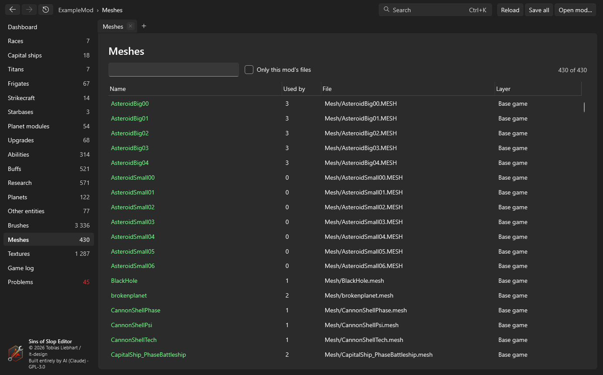
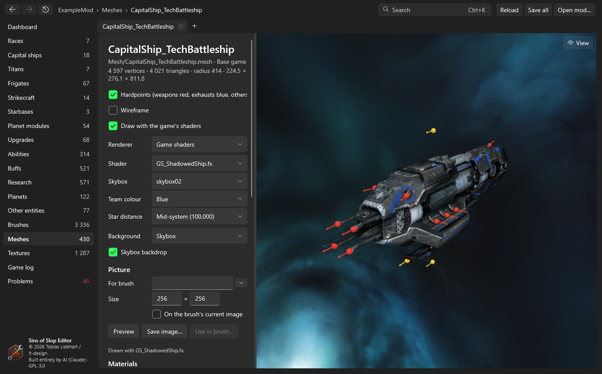
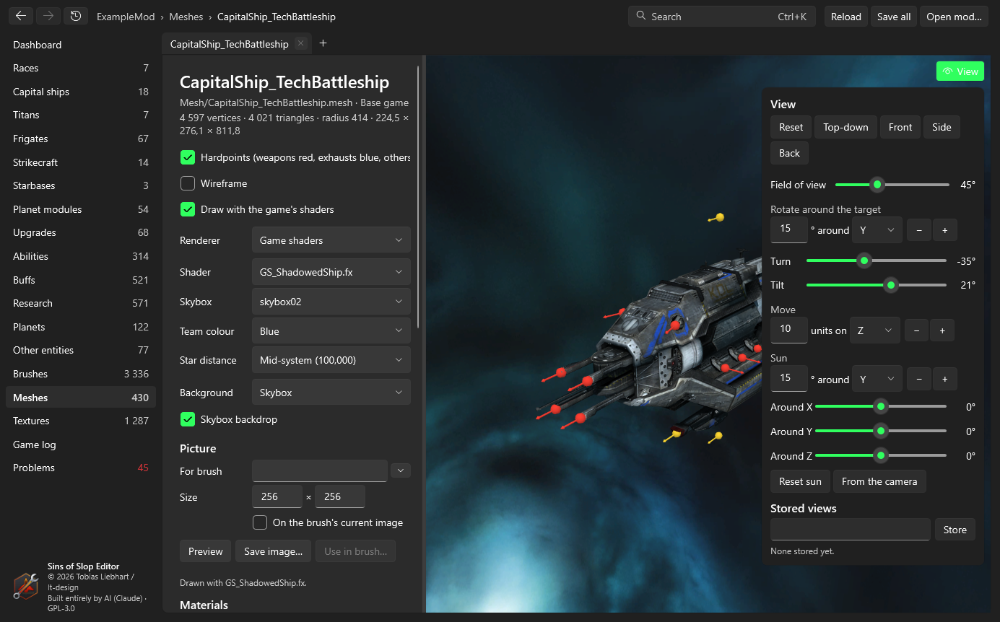
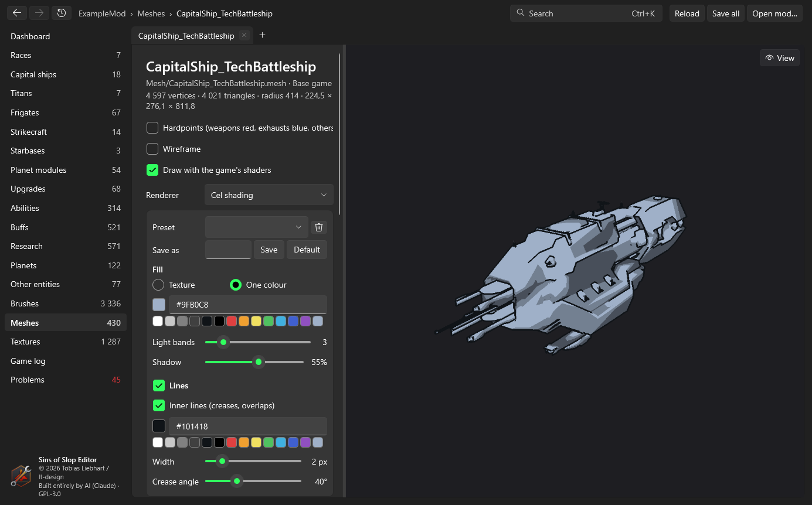

# Textures and meshes
{: .no_toc }

1. TOC
{:toc}

## Textures

**Textures** lists every texture (DDS and TGA) with its file, layer and what uses it. A texture page shows the image
fitted to the window or at **actual size**, on a checkerboard so transparency is visible, and the brushes and entities
that use it.

## Meshes

**Meshes** lists every mesh. A mesh page shows information about the mesh on the left and a 3D view on the right.

On the left:

- file, layer, vertex and triangle counts, bounding radius and size
- **Materials** – the textures of each material (diffuse, data, normal map, team colour), as links
- **Hardpoints** – the mesh's points (weapons, exhausts, abilities …) by kind
- **Attached particles** – particle effects on `Flair-` hardpoints, and the meshes they show
- **Scale** – see [Scaling](#scaling)
- **Used by** – the entities that use this mesh

## The 3D view

With **Draw with the game's shaders** on, the mesh is drawn by the game's own effect files from `PipelineEffect`
(your mod's versions first, so for example the SinsRemastered PBR shaders are used if your mod has them). Ships use
`GS_ShadowedShip`, asteroids `GS_ShadowedAsteroid`, planets `GS_Planet`, with their diffuse, data, normal and team
colour textures, a shadow from the sun and the skybox's reflections. Without it, a simple textured preview is shown.

**Mouse:** drag to turn around the model, wheel to zoom, middle button or Shift+drag to move, double-click to frame the
mesh again.

Settings on the left:

| Setting | What it does |
|---|---|
| Hardpoints | Shows the mesh's points: weapons red, exhausts blue, others yellow, with their direction. |
| Wireframe | Draws the triangles' edges over the mesh. |
| Renderer | *Game shaders*, or the editor's [cel shading](#cel-shading) for icons. |
| Shader | The effect file used for the main mesh (chosen from the mesh's kind; any can be picked). |
| Skybox | The skybox whose environment and light the ship reflects. |
| Team colour | The team colour on the team-coloured parts. |
| Star distance | How far the sun is. PBR shaders such as SinsRemastered's light ships brighter close to a star. |
| Background | The skybox, a picture file, a brush's image, or nothing. |
| Skybox backdrop | Draws the skybox itself behind the ship (off: only its reflections and light). |
| Cloud layer | For planets: the cloud pass. |

### Particles and playback

Particle effects on `Flair-` hardpoints are simulated and drawn: sprites (engine glows, blinking lights) and particle
meshes (for example a turning section of a station). **Particles** switches them on and off.

The playback controls go back to the start, step back, play/pause, step forward, and set the speed (0.1× to 4×); the
slider moves through the first 120 seconds (or longer for effects that last longer). Emitters start at their
`StartTime`, as in the game.

### The View palette

**View** at the top right of the 3D view slides in a palette:

- **Reset**, **Top-down** (from above, bow up), **Front**, **Side**, **Back** – standard views.
- **Field of view** – 5° to 120°.
- **Rotate around the target** – turn by a number of degrees around X, Y or Z with − and +, or use the **Turn** and
  **Tilt** sliders.
- **Move** – move the camera and its target by a number of units along X, Y or Z.
- **Sun** – turn the sun around the model: degrees around X, Y or Z with − and +, or the **Around X/Y/Z** sliders.
  **Reset sun** puts it back; **From the camera** lights the side you're looking at.
- **Stored views** – type a name and **Store** to keep the camera, field of view, playback time and sun. Click a stored
  view to go back to it, the bin to delete it. Stored views belong to the mesh and are kept in the editor's settings.

Each tab keeps its own camera, time and settings while it's open.

## Cel shading

**Renderer → Cel shading** draws the meshes with the editor's own shaders (built into the editor, not taken from the
game or the mod) in a flat, comic-like style – useful for HUD icons that should look like the game's.

| Setting | What it does |
|---|---|
| Fill | The mesh's **texture** (optionally with the team colour on its team-coloured parts) or **one colour** (type `#RRGGBB` or click a swatch). |
| Light bands | 1 to 16 brightness steps: 1 is flat, 2 is lit and shadow, more gives smoother light. |
| Shadow | How dark the darkest band is. |
| Lines | Lines along the outline. **Inner lines** adds lines at creases and where parts overlap. |
| Line colour, width | Colour, and width in pixels of the view – or of the picture when exporting. |
| Crease angle | Surfaces meeting at a sharper angle than this get a line; lower means more lines. |

**Presets:** type a name and **Save** to keep the current style; pick a preset from the list to load it; the bin
deletes it; **Default** goes back to the editor's default style. Presets are kept in the editor's settings and work for
every mod.

The sun's direction (View palette) decides which side is lit; the background setting applies as with the game shaders
(for icons, choose *None*).

## Pictures and brush images

The **Picture** section renders the view as an image:

- **For brush** – pick a brush (type to search, or the arrow for the whole list): the picture gets the brush's size.
  Or enter a **size** yourself.
- **On the brush's current image** – draws the model over the brush's image, e.g. a button without its icon, keeping
  the image's transparency.
- **Preview** shows the result, **Save image…** writes a PNG, **Use in brush…** opens the brush editor with the picture
  as the new Normal image (other states generated).

Pictures are rendered four times larger and scaled down, so edges are smooth; hardpoints and the wireframe are left
out, and without a background the picture is transparent around the model.

## Scaling

The **Scale** section resizes a mesh to a target size:

- **Global scale** – how many game units are one meter, the same for every mesh (an editor setting).
- **Measure along** – the longest side, length (Z), width (X) or height (Y).
- **Target size** in meters; the editor shows the current size and the factor.
- **Save as a new mesh** (with a name) or **Replace this mesh in the mod**.

Vertex and hardpoint positions and the bounds are scaled. Particle effects on `Flair-` hardpoints go along: their
meshes get the same factor and their emitters' positions are scaled. A copy also copies those particles and meshes with
the copy's suffix (OmegaM → OmegaM_Big: OmegaRotate_Big, OmegaR_Big), so other users of the originals are untouched.
Binary meshes are written binary again through the game's `ConvertData`.
