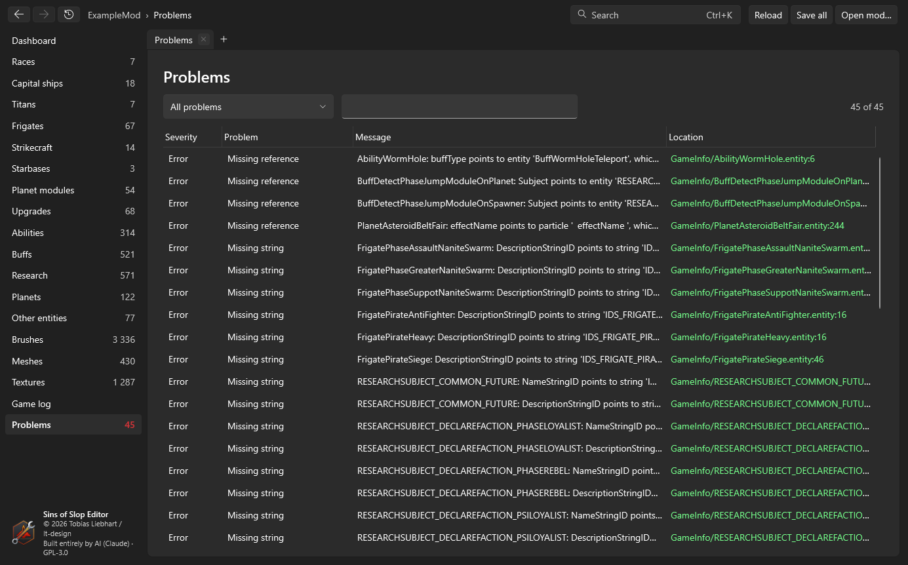

# Problems and game log
{: .no_toc }

1. TOC
{:toc}

## Problems

**Problems** in the sidebar lists everything the editor finds wrong with the mod, with severity, kind, message and
location. Search messages and paths; click a row to open the entity at that line, or the file. The
[dashboard](dashboard.html#problems) groups the same list and offers fixes.

What is checked:

| Kind | Severity | Meaning |
|---|---|---|
| Missing reference | error | An entity points to an entity, brush, mesh, texture, particle or sound that doesn't exist (or isn't in `entity.manifest`). |
| Missing string | error | A string ID used by an entity isn't in the string table of the current language. |
| Manifest entry without file, entity not in manifest, duplicate manifest entry, manifest count mismatch | error / warning | `entity.manifest` and the files don't match; the game won't load what isn't listed. |
| Count doesn't match the list | error | A counter (`numWeapons` …) says a different number than the list has. |
| Value of the wrong kind | warning | A value isn't what the game expects there, e.g. `"TRUE"` in quotes or `0,5` with a comma. Learned from the base game and base mods. |
| Unknown property | note | A key the base game never uses in that kind of entity – often a typo. |
| Duplicate string, string defined in several places, string count mismatch | warning / error | The string table repeats IDs, splits variants up, or its `NumStrings` is wrong. |
| Duplicate brush, missing brush file, brush image outside texture | warning / error | Brush definitions that clash or point outside their texture. |
| Encoding or line endings | warning | A file of the mod isn't in the game's encoding or doesn't use Windows line endings. |
| Unused entity | note | An entity of the mod nothing refers to. |
| Conversion failed | error | A binary file `ConvertData` couldn't read. |
| AI can't play a race fully | warning | See below. |

### What the AI needs

The game's AI follows fixed build orders: it looks for ships and planet modules by their **role** in the race's lists
and researches its way to them. If one is missing, or only reachable through research it can't get, the AI stalls or
never expands. For every selectable race the editor checks:

- frigates: a **colony** frigate, a **scout**, a **constructor** (`ModuleConstructor`) and a **combat** frigate – from
  the start;
- planet modules: a **frigate factory**, **metal** and **crystal extractors** from the start; a **capital ship
  factory** and **military and civic research labs** reachable;
- at least one **capital ship**;
- research to colonise the planet types the base game locks behind research (Ice, Volcanic, Greenhouse, Iron, Oceanic),
  on the race's research list and reachable.

"Reachable" means every prerequisite is on the race's research list and reachable itself, without cycles. The base
game's races pass all checks. These are warnings: a mod may do things differently on purpose.

## Game log

The game writes a log into its `Debug` folder each time it runs. **Game log** reads the newest log in which your mod
was enabled (or one you pick with **Browse…**) and groups its messages: what kind they are, how often they appear,
how severe they are, and where.

- Locations are links: a file or entity of the mod opens in the editor (a parse error at the reported line).
- **Only this mod** hides messages about other mods and the base game.
- **Engine checks and shaders** shows the engine's internal checks and shader compiler output, which rarely point at
  mod data.
- **Reload** reads the log again, e.g. while the game is still running.
