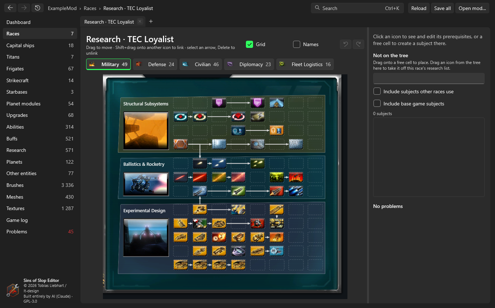

# Research trees

**Open research tree** on a race page shows the race's research screen the way the game draws it – its blocks,
backdrops, pictures, buttons and arrows, from the race's own `researchScreenData` and brushes.

## Reading the tree

- **Field tabs** at the top: Combat, Defense, Non-combat, Diplomacy, Fleet (and Artifacts if the race has any), with the
  number of subjects and a warning sign if one of them has a problem.
- **Arrows** run from a prerequisite to the subjects that need it, in the shapes the game draws. A prerequisite on
  another tab shows as a small badge with that tab's icon (click it to go there); a **?** badge means the prerequisite
  has no place on the research screen.
- **Grid** shows the free cells of every block as dashed boxes; **Names** shows the subjects' names under their icons.

## Changing it

- **Select** a subject to see its details on the right: field, block, cell, tier, levels, prerequisites and what it
  unlocks. **Open entity** opens it.
- **Move:** drag a subject onto a free cell. Dropping it on another subject swaps the two.
- **Prerequisites:** drag a subject onto another with **Shift** held to make the second require the first, or use
  **Add** in the details. Select an arrow and press **Delete** to remove that prerequisite.
- **Not on the tree:** the list on the right shows subjects on the race's research list without a valid place, and
  subjects no race uses (optionally also those of other races and of the base game). Drag one onto a free cell to
  place it (and add it to the race's research list); drag an icon from the tree onto the list to take it off.
- **New subject:** click a **free cell**. The panel *New subject here* suggests the nearest subject as the one to copy
  and a free name. **Create subject** makes the copy (with its own copies of the name and description strings),
  places it in that cell with tier = column and no prerequisites, adds it to `entity.manifest` and the race's research
  list, and selects it after the mod has reloaded. Open edits are saved or discarded first.
- **Undo/redo** work for the whole tree; every change is an edit of the subjects and the race, saved with **Save all**.

The issues list at the bottom shows what's wrong: subjects without a position, in a block the race's screen doesn't
have, outside their block or sharing a cell; prerequisites that don't exist, that aren't on the race's research list or
that ask for more levels than the subject has; links no arrow image of the game can draw; cycles; and (as a note) subjects whose tier differs from their column.
Click an issue to select the subject.

{: .note }
Some mods give blocks overlapping areas. The editor offers free cells only up to where the next block starts, because
the game draws that block over them.
